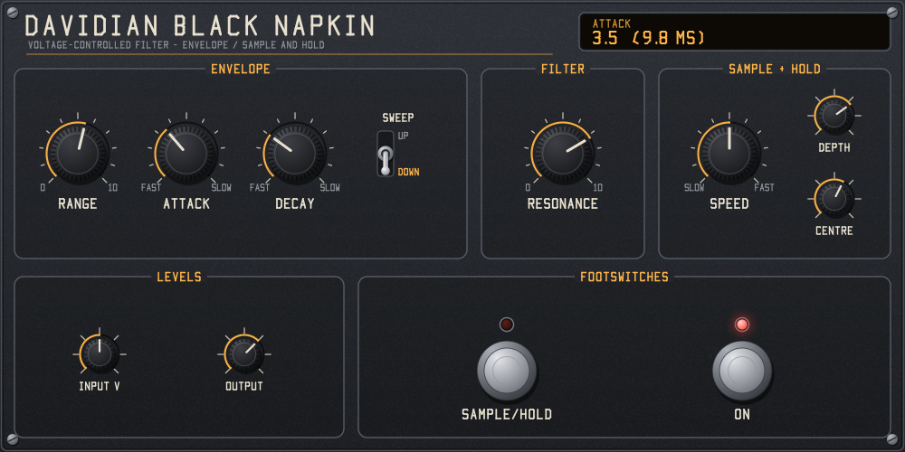

# Davidian Black Napkin

A circuit-modelled filter pedal plugin (LV2, VST3 and Audio Unit), modelled on a 1970s-style voltage-controlled filter pedal: a resonant band-pass made from two transconductance amplifiers (OTAs), swept either by an envelope follower with attack, decay and an up/down switch, or by a sample and hold that grabs transistor noise at a clock rate you set, for stepped random filter moves.

**A close model, not an exact copy.** It is a simulation of the circuit from its component values, not a sampled or measured pedal, and some details are reasoned estimates (listed under [Estimates](#estimates)). It has not been compared side by side with a built unit, so expect it to sound close to the hardware rather than identical.



A mono effect (mono or stereo tracks work too), with the same GUI in every format. GPL-3.0-or-later.

| Format | Windows | macOS | Linux |
|---|---|---|---|
| LV2 | yes | yes | yes |
| VST3 | yes | | |
| Audio Unit (AUv2) | | yes | |

## Download

Ready-made builds are on the [Releases page](https://github.com/evadavevadave/davidian-black-napkin/releases):

| Download | Contains | For |
|---|---|---|
| `…-windows-x64.zip` | LV2, VST3 | Windows 10/11, 64-bit hosts |
| `…-macos-universal.zip` | LV2, Audio Unit | macOS 10.13 or later, Apple silicon and Intel |
| `…-linux-x64.zip` | LV2 | 64-bit Intel/AMD Linux (glibc 2.35 or later) |
| `…-linux-arm64.zip` | LV2 | 64-bit ARM Linux, e.g. Raspberry Pi 4/5 (glibc 2.35 or later) |

Unzip, copy the plugin folder for your host's format into its plugin folder, and restart your host (or rescan plugins):

| Format | Copy | Into |
|---|---|---|
| VST3 (Windows) | `black_napkin.vst3` | `C:\Program Files\Common Files\VST3` |
| Audio Unit (macOS) | `black_napkin.component` | `~/Library/Audio/Plug-Ins/Components` |
| LV2 (Windows) | `black_napkin.lv2` | `%APPDATA%\LV2` (create it if it doesn't exist) |
| LV2 (macOS) | `black_napkin.lv2` | `~/Library/Audio/Plug-Ins/LV2` |
| LV2 (Linux) | `black_napkin.lv2` | `~/.lv2` |

In the host it is listed as **Davidian Black Napkin** (VST3, LV2) or under **Davidian** as **Black Napkin** (Audio Unit).

The macOS build isn't notarized, so macOS may block it after download. Run these once in Terminal after copying:

```bash
xattr -dr com.apple.quarantine ~/Library/Audio/Plug-Ins/Components/black_napkin.component
```

```bash
xattr -dr com.apple.quarantine ~/Library/Audio/Plug-Ins/LV2/black_napkin.lv2
```

Logic Pro and GarageBand only show an Audio Unit once macOS has registered it. If it doesn't appear, log out and back in, or restart the Mac.

## Controls

| Panel | Control | Circuit part |
|---|---|---|
| Envelope | Range | 100k linear pot feeding the envelope rectifier: how far your playing opens the filter |
| Envelope | Attack | 5k linear pot (plus 330R) charging the 4.7uF envelope capacitor: about 1.6 to 25 ms |
| Envelope | Decay | 1M linear pot (plus 10k) discharging it: about 50 ms to 4.7 s time constant |
| Envelope | Sweep: Up / Down | DPDT switch: the envelope buffer follows the envelope (up) or inverts it, so the filter starts high and closes as you play (down) |
| Filter | Resonance | 2M linear pot in the band-pass feedback: Q from about 1 to 21, with the matching rise in level at the peak |
| Sample + Hold | Speed | 1M reverse-audio pot on the sample clock: about 1.5 to 10 Hz |
| Sample + Hold | Depth, Centre | The two internal trimmers: noise level into the sample and hold (10k) and its centre point (100k) |
| Levels | Input V, Output | Volts at the input jack for a 0 dBFS sample; output level |
| Footswitches | Sample/Hold | The mode switch: envelope filter (LED off) or sample and hold (LED on) |
| Footswitches | On | Plugin bypass, delayed to match the latency. In VST3 it is the host's bypass switch, and in an Audio Unit host's bypass turns it off. |

Attack, Decay, Range and Sweep only act in envelope mode; Speed, Depth and Centre only in sample-and-hold mode, as in the circuit. The display shows the attack and decay time constants and the clock rate as you turn them.

The output is the band-pass, as on the pedal, so a steady low note through a filter set high comes out quiet: the effect needs the envelope (or the clock) to move the filter across your notes. At high Resonance the peak is up to 26 dB louder than the input; use Output to compensate. Input V matters more here than on most effects, because the envelope follows the input level: lower it if the filter stays open, raise it if it barely moves.

On a stereo track the VST3 and Audio Unit versions mix the two inputs to mono and send the output to both sides. Their parameters show the knobs as 0 to 10 (VST3) or 0 to 1 (Audio Unit and LV2).

Knobs read 0 to 10. Drag up or down, hold Shift to fine-tune, use the mouse wheel, and double-click to reset.

## How it is modelled

All in `src/filter.h`, with the circuit's part values.

- **Filter:** two OTA integrators (1 nF, then 30 nF, with a JFET buffer after the first) in a loop make a state-variable band-pass. The input reaches the first OTA through a 100k / 3k3 divider, and the band-pass output comes back through 100k plus the Resonance pot. Each OTA is modelled as `Iabc tanh(Vin / 2VT)`, so loud notes and high resonance compress and grit the way the chip does, and the buffer clips at the supply rails. The equations are solved each sample with trapezoidal integration, prewarped at the centre frequency, and the OTA gains are re-estimated twice per sample. Small-signal centre frequency is `Iabc / 2VT * sqrt(b / C1 C2)`, about 120 Hz to 16 kHz over the control range.
- **Bias current:** a PNP transistor with a grounded base turns the control voltage into the OTAs' bias current (22k from the envelope, 100k from the sample and hold, 1M from +9 V). A 2M7 trickle keeps the filter at about 120 Hz when it is off, and 150 nF smooths the current (1.6 ms).
- **Envelope:** a precision half-wave rectifier (gain 1M / 22k, 1M / 7k8 when sweeping down), set by Range, charges 4.7 uF through the Attack resistance; the Decay resistance pulls it towards -9 V, and the rectifier holds it at 0 V between notes. The down sweep is the op-amp's inverting connection about 3.6 V.
- **Sample and hold:** a Schmitt-trigger clock (330 nF, 180k plus the Speed pot) samples Gaussian noise, clipped at the op-amp's swing, onto the hold capacitor. The noise is generated, not recorded.
- **Oversampling** (`src/oversample.h`): 4x at 44.1/48 kHz, 2x at 88.2/96 kHz, none above. The latency is 32 samples (0 when not oversampling), and the plugin reports it to the host.

### Checked against the formulas

`test_dsp` measures the model's band-pass with a small sine and compares it with the small-signal formulas: the centre frequency is within 1.5% from 120 Hz to 15 kHz, the peak gain within 1% and the -3 dB points within 0.03 of 0.707, at every Resonance setting. It also checks the attack and decay times, the clock rate at three Speed settings, both sweep directions, the sample-and-hold steps, OTA limiting on loud input, bypass latency, silence and every sample rate.

### Estimates

The circuit's part values are known, but not every operating detail, so these are reasoned estimates:

- The trickle current through the 2M7 resistor (taken as 2.4 uA from the OTA bias pins at about -6.5 V), and the JFET buffer's 1.5 V gate-to-source offset in the hold buffer.
- The amount of transistor noise (2.5 V rms after amplification); the Depth trimmer scales it.
- How the Centre trimmer feeds in: modelled as shifting the sample-and-hold voltage by up to +/-4.5 V. Its default (6 of 10) keeps most steps above the bottom of the range.
- The Schmitt trigger's thresholds (0.68 of the op-amp swing, from its 22k / 47k divider) and the 12k that switches in with the down sweep.
- Op-amp swing of +/-7.5 V on the +/-9 V supply.

## Build

The code is plain C11 (Objective-C for the macOS GUI and Audio Unit) with no dependencies beyond the platform's own libraries: Win32 on Windows, Cocoa and AudioToolbox on macOS, Xlib on Linux and BSD. No LV2, VST3 or AU SDK is needed: the VST3 version uses Steinberg's one-file C API header, included in `src/vst3/`.

| Source | What it is |
|---|---|
| `src/engine.h`, `src/filter.h` | The circuit model, shared by every format |
| `src/plugin.c`, `src/ui/ui_lv2.c` | LV2 plugin and GUI |
| `src/vst3/vst3.c` | VST3 plugin, with its editor |
| `src/au/au.m` | Audio Unit, with its Cocoa view |
| `src/ui/panel.h`, `src/ui/window.h` | The panel and the window layer under it, shared by every GUI |

### Windows (Visual Studio)

Needs Visual Studio 2019 or later with the C++ workload. `build.bat` finds it on its own, and builds `build\black_napkin.lv2` and `build\black_napkin.vst3`.

```bash
build.bat
```

### macOS, Linux, BSD, MinGW

Needs a C compiler and `make`. On Linux, also the X11 headers (`libx11-dev` on Debian/Ubuntu). On macOS, the Xcode command-line tools; the build is universal (Apple silicon and Intel) and also makes the Audio Unit, `build/black_napkin.component`.

```bash
make
```

```bash
make install
```

`make install` copies the LV2 bundle to your user LV2 folder, and on macOS the Audio Unit to `~/Library/Audio/Plug-Ins/Components`.

## Tests

Windows:

```bash
build.bat test
```

macOS, Linux:

```bash
make test
```

- `test_dsp` checks the filter against its formulas, the envelope and clock timing, the plugin's behaviour in both modes and directions, bypass latency, silence, all sample rates and CPU cost (about 2% of one core at 48 kHz on the development machine).
- `ui_render` draws the panel to a BMP file.
- `ui_check` (Windows) and `ui_check_mac` (macOS) load the GUI the way a host does, drive it with mouse events and check the values it sends back.
- `load_check` (Linux, macOS) loads the plugin and GUI with `dlopen` and runs them.
- `lilv_check` (Windows) validates the bundle with the LV2 parser from an Ardour 9 install: `build-test\lilv_check.exe build`. On Linux, CI checks it with `lv2info`.
- `vst3_check` (Windows) loads the VST3 the way a host does and checks the factory, buses, parameters, audio, latency, bypass and saved state, then opens the editor and drives it with the mouse, checking each edit reaches the host inside a begin/end gesture.
- `au_check_mac` (macOS) opens the installed Audio Unit and checks the same things, including its Cocoa view. Run `make install` first.

CI also runs Steinberg's VST3 validator on the Windows build and Apple's `auval -strict` on the Audio Unit.

GitHub Actions runs all of these on Windows, macOS, Linux x64 and Linux arm64 for every push (see `.github/workflows/build.yml`). Pushing a `v*` tag publishes a release with a zip for each platform.

## Use of AI

Made with generative AI (Claude Code), directed and reviewed by Davidian. See [AI_USAGE.md](AI_USAGE.md) for what the author and the AI each did, and what has and hasn't been checked.

## References

- OTA transfer function: the differential pair's `I = Iabc tanh(Vd / 2VT)`, as in the CA3080 and LM13700 data sheets.
- Trapezoidal integration with prewarping for state-variable filters: Vadim Zavalishin, *The Art of VA Filter Design* (2012/2018).
- Polyphase Kaiser-windowed sinc oversampling: standard multirate DSP (e.g. Lyons, *Understanding Digital Signal Processing*).

## Licence

GPL-3.0-or-later. See [LICENSE](LICENSE), [NOTICE.md](NOTICE.md) and [AI_USAGE.md](AI_USAGE.md).
